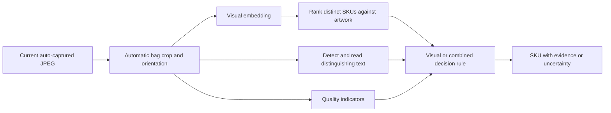

# Experiment plan: cement-bag SKU recognition

## 1. Scope and research questions

Test software using existing auto-captured JPEGs and the current camera and lighting. No lighting purchases, light-placement studies, strobe experiments, or camera changes are included. Use real low-light/dusty captures when available; software corruption is a separate stress test.

| Question | Evidence required |
|---|---|
| Does artwork resemble the captured bag sufficiently for retrieval? | Frozen encoder plus artwork-only gallery evaluated on real photos |
| Can new SKUs be enrolled without retraining? | Entire SKU identities excluded from development training, then artwork-only enrollment after pipeline freeze |
| Do low-light software methods improve identification? | Paired comparison on identical bags, including normally illuminated images |
| Does OCR resolve similar-looking SKUs? | Visual-only, OCR-only, and combined results on genuine confusing pairs |
| Can the model recognize when evidence is insufficient? | Fixed rejection policy tested on unenrolled SKUs and degraded images |
| Is the resulting pipeline fast enough? | End-to-end latency and sustained throughput on the intended compute device |

Two enrollment requirements must remain distinguishable:

- **Track A: no project-specific model training.** All pretrained components stay frozen. Validation can choose preprocessing and decision thresholds; this is still calibration, not a claim of zero development data.
- **Track B: no retraining per new SKU.** Models may be adapted once using development SKUs, then frozen. New SKUs contribute artwork and verified text metadata only.

Track A is the required first baseline. Track B is conditional on failure analysis and availability of labeled development photos. Neither track uses camera photos of final held-out SKUs for training or enrollment.

## 2. Hypotheses to test

| ID | Hypothesis | Comparison |
|---|---|---|
| H1 | Frozen visual features can bridge at least part of the artwork-to-bag gap | Artwork retrieval versus SIFT; held-out-SKU recognition |
| H2 | Print-aware cropping and higher resolution retain useful SKU details | Same encoder at 224 versus 448 pixels; whole bag versus fixed identifying regions |
| H3 | Low-light correction improves dark-image recognition without harming other conditions excessively | Original versus simple correction versus one learned enhancer |
| H4 | OCR improves discrimination when candidate SKUs differ in text | Visual-only versus OCR-only versus combined |
| H5 | One-time contrastive adaptation improves unseen-SKU matching | Frozen backbone versus trained projection head; same final artwork-only protocol |
| H6 | Rejection reduces incorrect acceptance of unenrolled or unreadable bags | Forced top-1 versus score/margin/quality rejection; coverage reported |

These hypotheses can fail. Negative results, such as brightening hurting OCR or OCR adding no value, should be retained in the report.

## 3. Common pipeline and controls

Begin with one bag per image and a fixed region of interest derived from development images. Include failed or partial captures in the end-to-end results. If framing varies enough to break the fixed crop, compare a generic bag detector as a separate preprocessing experiment. Manual ground-truth crops are allowed only for a diagnostic upper bound; label that run `oracle_crop` and never present it as automatic production accuracy.

Prepare visible artwork panels by removing print guides, margins, and non-visible panels. Record revision and visible side. Retain identifying colors. Use the same approved panels and reference-count policy for all methods. Store normalized features and search with exact cosine similarity; approximately 40 SKUs do not justify approximate indexing in the baseline.

Start with a pretrained small ViT from DINOv2 and a comparable small DINOv3 checkpoint. Record exact checkpoint identifiers. Use 224- and 448-pixel inputs as an initial validation grid; both are divisible by the usual 14/16-pixel patch sizes, but verify the selected implementation's supported preprocessing. Record pooling, resize, padding, and normalization. Similar-sized backbones and matched image settings make comparisons interpretable; report actual memory and timing as well.

If bag orientation is unpredictable, select an automatic orientation policy on validation data. A fallback is scoring four right-angle query rotations and taking the best score per SKU. Apply the same policy across comparable visual runs, count its extra compute, and recalibrate rejection for that policy. Do not manually orient individual test queries.

Use up to three distinct candidate SKUs for OCR verification. Multiple panels from one SKU must not occupy all candidate positions. Rank by maximum panel cosine score initially, with the same cap on panel/view count per SKU. Any later aggregation change is a separate validation choice.

## 4. Experiment matrix

| ID | Experiment | Change from control | Required data | Primary outcome |
|---|---|---|---|---|
| E00 | Data and capture audit | No model | Current ZIP; verified labels/artwork when available | Establish what can actually be evaluated |
| E01 | Visual baselines | SIFT, frozen DINOv2, frozen DINOv3 | Multiple labeled SKUs and artwork | Top-1 and top-3 distinct-SKU accuracy |
| E02 | Detail preservation | Resolution and identifying-region representation | E01 data; artwork region definitions | Confusions resolved versus extra compute |
| E03 | Low-light preprocessing | Original, gamma, CLAHE, one learned enhancer | Same validation queries; natural low-light tags | All-bag and low-light subgroup accuracy |
| E04 | OCR diagnosis | Predicted versus verified text crops; original versus corrected | Labeled identifying text | Detection recall, character/code accuracy |
| E05 | OCR fusion | Visual-only, OCR-only, combined | Same queries and artwork text metadata | Final SKU gain and new errors introduced |
| E06 | New-SKU enrollment | Add only held-out artwork after freeze | Held-out SKU photos, inaccessible during development | Artwork-only new-SKU accuracy |
| E07 | Unknowns and robustness | Gallery withholding; real/synthetic degradation | E06 queries plus challenge sets | False acceptance, coverage, degradation curves |
| E08 | Runtime replay | Full selected pipeline, measured input rate | Intended compute; actual or documented replay load | Latency, throughput, queue growth |
| E09 | Optional one-time training | Projection head and degradation consistency | Labeled development SKUs only | Improvement that transfers to unseen SKUs |
| E10 | Optional photo-assisted comparison | Add 1 or 5 verified gallery photos per SKU | Separate enrollment photos | Cost of enforcing artwork-only enrollment |

E00–E08 form the main study; E09 and E10 answer follow-up questions if needed. E06–E08 are locked final evaluations, after model selection. Development versions of enrollment, unknown, and runtime tests use validation identities/images first.

## 5. E00–E02: establish the visual baseline

**E00:** inventory all files, confirm whether sequential images show separate physical bags, identify duplicate/near-duplicate groups, and inspect labels and timestamps. Current sample filenames do not establish reliable production time. The existing archive can test crop/OCR usability even if it contains one SKU; it cannot prove multi-SKU recognition. Follow the data protocol before splitting.

**E01:** compare SIFT matching and frozen DINO retrieval with identical automatic bag crops, artwork references, and validation queries. For SIFT, record matching and geometric checks; inspect whether matches cover identifying print rather than only the shared logo. Fit match-score acceptance only on validation. For DINO, compare cosine ranking before adding rejection. The headline ranking result must include the correct SKU among all enrolled alternatives.

**E02:** on the better encoder, compare 224 versus 448 pixels. Then compare whole-bag features with whole-bag plus identifying-region features. Define regions from artwork/development observations and transfer them automatically using the frozen alignment/crop policy. Use equal weights first; permit a small validation grid for the whole/region weight. If automatic alignment fails, report that failure. A manually selected query patch is a diagnostic run, not a deployable improvement.

Stop adding visual complexity when validation confusions no longer justify it. Save the selected visual pipeline as the control for E03–E05.

## 6. E03: software handling of low light

Test each preprocessing method independently against the original control:

1. Original image.
2. Gamma correction using `output = input ** gamma` on normalized pixels, with validation candidates `0.6`, `0.8`, `1.0`.
3. CLAHE on luminance only, with clip limits `1`, `2`, `4` and a fixed `8 x 8` tile grid as an initial proposal.
4. One compatible pretrained JPEG/RGB enhancer: start with Zero-DCE; consider Retinexformer only if the first comparison and failure analysis justify it.

Choose parameters globally on validation, not separately using each test image's ground truth. An adaptive policy must use image statistics with its rules frozen before test. For an enhancer that improves query darkness but distorts bright artwork, keep reference preparation separate and explicit; compare the original-gallery/processed-query policy first. Do not blindly brighten clean artwork. Store originals and record whether processing applies to queries, references, or both.

Report dark-image gains, normal-image regressions, identifying-text accuracy, and processing cost. If simple correction helps as much as a learned method, prefer the simpler method. If none helps, keep original RGB and investigate features or OCR rather than assuming brighter output is better.

## 7. E04–E05: low-light OCR and fusion

Use a pretrained text detector plus PaddleOCR's `th_PP-OCRv5_mobile_rec` for Thai/English/numbers as the first candidate. Pin its exact model and software versions. Do not assume a general English recognizer reads Thai. Text-aware papers provide extensions if this baseline fails; they are not interchangeable pretrained Thai systems.

For E04, evaluate two paths on the same annotated identifying text:

- **Automatic path:** detect text in the full bag crop and recognize detected lines. Missing a line is a failure in end-to-end identifying-text recall.
- **Diagnostic path:** recognize verified text crops. This isolates character recognition from text-localization failure and is not the deployed result.

Compare original, selected simple correction, and a compatible text-aware enhancer when available. If no compatible pretrained text-aware model exists, mark that experiment `not_run`; do not relabel generic brightening as a published text-aware model. Investigate lower-noise preprocessing and resolution before introducing new training.

For E05, use verified artwork metadata containing SKU-specific product names, grades, and codes. Do not treat a shared brand name as strong identifying evidence. Normalize Unicode consistently; preserve Thai marks and meaningful digits. Any allowed spelling/spacing equivalence must be documented before final testing.

Initial fusion experiment:

1. Visual-only decision with the calibrated score/margin policy.
2. OCR-only ranking against all enrolled text metadata, with rejection for missing/ambiguous evidence.
3. Combined decision: retrieve three distinct visual candidates, compare their distinguishing text, and accept only if the frozen combined rule provides sufficient separation.

A reproducible first combined score is `S(sku) = (1 - w) * V(sku) + w * T(sku)`. `V` is cosine similarity rescaled to `[0,1]`; `T` is a validation-defined weighted text similarity in `[0,1]`, such as normalized edit similarity with explicit code weights. These are ranking scores, not probabilities. Test `w = 0`, `0.25`, `0.5` on validation. Missing text falls back to the visual rule; contradictory reliable identifying text triggers uncertainty unless a separately validated rule resolves it. OCR confidence cutoffs, contradiction rules, and string weights are part of the frozen configuration.

Report both all-image OCR and selective OCR on ambiguous visual results. A selective policy must use the visual margin, not knowledge of which predictions are wrong. Track the rate at which the true SKU is absent from the visual top three; OCR verification cannot recover a candidate that was never considered.

## 8. E06–E07: enrollment, unknowns, and robustness

Freeze all components and thresholds after validation. Final held-out SKU camera photos have not contributed to training, model selection, cropping rules, or acceptance thresholds.

**Enrollment challenge:** evaluate new-SKU photos first against the gallery without those SKUs, then add only their artwork panels and verified artwork text. Run the same photos again against the expanded gallery. Model/checkpoint hashes and decision settings must remain identical. Measure recognition of the new SKUs and interference with existing SKUs after gallery expansion. A gallery update may change score margins naturally; do not retune thresholds from final results.

**Unknown challenge:** the pre-enrollment pass supplies unenrolled but realistic cement-bag queries. Add genuinely out-of-catalog SKU photos if available, plus no-bag/partial/unreadable examples in separate categories. Withhold entire SKU galleries, not just one reference panel. Use validation identities for any earlier rejection tuning. Report post-enrollment test results separately from pre-enrollment unknown rejection.

**Real conditions:** natural low light, small text, folds, blur, airborne dust, lens/window contamination, and dust over print should be tagged separately. Multiple tags may apply. Human image-quality labels are descriptive; without capture metadata, they do not establish physical exposure or dust concentration.

**Synthetic stress test:** use paired transformations of held-out images without adding them to the primary test denominator. Proposed levels on normalized RGB: attenuation factors `0.8/0.5/0.25`; additive Gaussian noise standard deviations `0.01/0.03/0.06`; directional motion kernels `3/7/15` pixels; downsample factors `0.75/0.5/0.25` then restore the original dimensions; JPEG qualities `90/60/30`; and masks covering `10/25/40%` of a known identifying region. These are engineering probes, not calibrated camera physics. Mild attenuation alone does not simulate low-light sensor noise. Start with one corruption at a time; add darkening plus noise as a separate compound condition. Severe masks that remove all distinctions should elicit uncertainty, not confident invented details.

Keep transform seeds, base-image IDs, and severity definitions. Corrupted variants remain grouped with their source bag and are not independent new samples. Real factory robustness claims require real factory images.

## 9. E08: runtime and interface

Run the selected automatic pipeline on the intended device, with preprocessing, retrieval, conditional OCR, and logging included. Measure cold-start separately. Warm up, then replay at least 1,000 image events or the entire available evaluation set if smaller; repeats used for timing do not increase recognition sample size.

When production arrival rate is known, replay at that rate and at a proposed `1.5 x` burst rate. Otherwise sweep several documented rates and report the highest sustainable rate; do not claim production throughput compliance. Preserve event IDs, record queue delay, and check sustained queue growth and processing failures. Save per-image component timings and overall latency. Use reliable arrival/result timestamps; current placeholder filenames cannot establish capture-to-result latency.

The scope's end-to-end limit is 60 seconds. Local model time is only one part; if capture/upload timing cannot be measured, report worker latency and leave full-system compliance unverified.

## 10. Optional E09–E10 and decision gates

**E09:** if the artwork-to-photo gap remains the main error, train a small projection head over a frozen backbone using contrastive positives between artwork and development photos, with similar-SKU hard negatives. Compare: frozen baseline; contrastive head; contrastive head plus identity-preserving degradation and embedding consistency. Use three training seeds for finalists, validation-only model selection, and no final-SKU data. Sample realistic darkness/noise based on development captures. MAET-inspired degradation and FeatEnHancer-inspired task supervision are adaptations, not replications of their original detector results. Broad backbone fine-tuning is a later conditional experiment, not the first step.

**E10:** quantify the enrollment constraint by adding 1 and 5 separate verified real photos per SKU to the gallery while keeping the encoder frozen. Enrollment photos must be different physical bags/sessions from test queries. Perform this only after the artwork-only results are locked, so the assisted comparison cannot influence the primary solution. Report it as an alternative onboarding requirement, not as success on artwork-only enrollment.

| Observation | Next decision |
|---|---|
| Frozen retrieval already meets requirements | Keep the simplest successful pipeline; optional components need measurable benefit |
| Small-text SKUs fail while designs otherwise match | Run E02/E04/E05 |
| Dark-image subgroup fails | Run E03; consider E09 if learned features remain necessary |
| Artwork-only fails but photo-assisted succeeds | Report the domain gap and onboarding tradeoff explicitly |
| No useful identifying signal remains | Return uncertainty and state the software limit in the experiment report |
| Real test data is insufficient | Report a pilot result and the missing evidence; do not claim 40-SKU/factory acceptance |

No gate automatically adds lighting or hardware back into scope.

## 11. Research basis

The experiments derive from the [main research review](/Users/airadajitauleeruk/Desktop/capstone/output/research/cement-bag-recognition-research.md): Cat2Real/SupCon for artwork retrieval and development adaptation; DINOv2/DINOv3 and SIFT for visual baselines; Unitail for text evidence; MAET/FeatEnHancer for task-oriented low-light robustness; Zero-DCE/Retinexformer for preprocessing; Reading in the Dark, Text in the Dark, LIST, and Seeing Text in the Dark for OCR; TextZoom for resolution; DarkVision, ExtCon, AugMix, and ImageNet-C for evaluation design. Specific numeric grids in this plan are proposed experiments, not paper-certified optimal settings.
