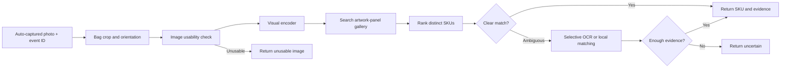

**Cement-bag SKU recognition: research and architecture recommendations**

Research checked on 11 October 2026. This review focuses on technical scope, auto-captured still images, and artwork-only enrollment of future SKUs. It does not adopt the project timeline or treat the earlier research notes as instructions.

Training-data details for the nine priority papers were checked on 12 October 2026. Counts below distinguish training from testing, foundation-model pretraining from task adaptation, and images from crops, paired exposures, and videos. Separate benchmark experiments should not be added together as one training set. These published dataset sizes are not minimum data requirements for the cement-bag project.

Current development scope: test models and software on the existing auto-captured images and current camera/lighting setup. Additional lights, lighting geometry, strobe equipment, and new capture hardware are excluded from the current plan. Evaluate robustness to the lighting variation already present in the images using feature learning, preprocessing, and OCR experiments.

**Understanding the project**

The Scope of Work describes a system replacing operator-selected SKU identities with camera-derived identities. The full system recognizes approximately 40 SKUs, counts physical bags, detects severe tears and visible leakage, and records Gross, Defect, and Good counts. It must support automatic SKU changes, production inactivity, more than 10 factories, artwork enrollment, and integration with the existing TypeScript platform and AWS IoT. The stated targets are SKU accuracy >=98%, counting accuracy >=98%, severe-defect recall >=98%, and end-to-end latency <=1 minute. These are project acceptance targets, not results established by the papers below.

The recognition module's responsibility is: given an auto-captured image containing a bag, identify its SKU or return uncertainty with traceable evidence. Counting and defect detection remain related modules. A photograph does not by itself prove that one new physical bag passed the line: event identity and trigger behavior must establish that relationship.

The user's clarification is that onboarding is undecided, but the hardest case is new artwork alone, without retraining. The recommendation therefore makes gallery retrieval the primary development path. A fixed classifier remains a comparison for existing SKUs. An encoder may be trained once on development SKUs, then frozen while new-SKU gallery entries are added; this is different from retraining the model for every new SKU. A frozen pretrained encoder should also be tested as the strict no-project-training baseline.

Local materials reviewed:

- Scope of Work.pdf, all 3 pages.
- Paper reserch 3d2bd9dc578c80ada785f31e3b853606.pdf, all 3 pages.
- 8c7e3c79-94ce-42d7-b4d5-eb59f4519f46_project_research_note.pdf, all 15 pages.
- data/SampleMortarBag.zip: archive inventory plus 24 images sampled across its ordering, with two sampled images also inspected at full image size.

**What the samples establish**

The ZIP contains 592 JPEGs, all 1408 x 1024. The sampled images have a fairly consistent top-down composition with one large bag and relatively little background. They appear to show the same blue/yellow DURA ONE packaging design. SKU labels and physical-bag identities were not supplied, so the review does not assert that every image belongs to one SKU or that 592 images represent 592 independent bags.

Visible issues include uneven illumination, darker edges, soft small lettering, wrinkles, and varying surface texture. Softness cannot be attributed conclusively to motion, focus, compression, or dust from images alone. Camera resolution is therefore only part of image quality: the number of readable pixels covering distinguishing printing is more relevant. This archive is useful for capture-quality experiments, but cannot establish 40-SKU classification accuracy, unseen-SKU enrollment, or robustness across factories. There is no basis here for claiming heavy airborne-dust coverage.

**Recommended changes to the earlier research plan**

- Keep embedding retrieval, but explicitly test the artwork-to-filled-bag domain gap. Catalog packshot results are relevant evidence, not proof that a flat print layout will match a wrinkled bag.
- Make robustness training and evaluation central. Compare original images against simple exposure normalization and learned enhancement. Select methods by SKU accuracy and coverage, rather than attractive output images.
- Use product-name, grade, and distinguishing panel features as well as overall design. A shared brand logo can create misleadingly strong similarity between different SKUs.
- Keep a supervised classifier as a known-SKU benchmark; it does not satisfy new-artwork enrollment by itself.
- Treat SIFT and learned local matching as inexpensive baselines or selective verification experiments. They should not determine the architecture before actual blurred and folded images are tested.
- Do not use video tracking or temporal voting as a required component of still-image recognition. Multiple captures can help only if their association with the same physical bag is reliable.

**Paper shortlist: recognition and artwork enrollment**

1. **Bridging the Catalog-to-Real Gap: Scalable Product Recognition via Multi-Stage Contrastive Learning — Zhang, Mazumder, and Lomakin, July 2026 preprint (Cat2Real).**

   **Training data:** 196,531 real product crops covering 26,910 photographed product identities; the catalog training pool contains 409,891 images covering 45,243 product identities. Training adapts pretrained DINO encoders using these sources and staged filtering/negative sampling. The 5,043 evaluation queries are excluded from these counts. Catalog photographs are not flat cement-bag artwork. [Dataset statistics, Table 4](https://arxiv.org/html/2607.09888v1).

   Learns retrieval embeddings using staged contrastive training, similar-product hard negatives, and suitable reference views. The paper reports 80.73% category-macro top-1 accuracy and 94.70% top-5, with 80.23% top-1 when evaluation products are excluded from training. It evaluates 5,043 real crops against 2,155 products. This is the strongest architectural match for expandable SKU galleries. Its references are catalog photographs, not cement print artwork, and its results do not establish the project's 98% target. [Paper and tables](https://arxiv.org/html/2607.09888v1).

2. **DINOv2: Learning Robust Visual Features without Supervision — Oquab et al., 2023.**

   **Training data:** LVD-142M, a curated collection of 142,109,386 images (approximately 142 million), used for self-supervised foundation-model pretraining. These are general images without cement-SKU labels. Smaller models use teacher distillation. Reusing a released checkpoint does not require collecting or retraining on this dataset. [Pretraining dataset](https://arxiv.org/html/2304.07193v2).

   Provides reusable pretrained image and patch features. Start with normalized image embeddings and cosine similarity against artwork panels. Benchmark both whole-bag and distinguishing-region representations. A foundation-model feature is a baseline, not evidence of dust or cement-SKU robustness. [Paper](https://arxiv.org/abs/2304.07193), [official code and weights](https://github.com/facebookresearch/dinov2).

3. **DINOv3 — Simeoni et al., 2025 technical report.**

   Develops stronger general visual representations and dense features, including Gram anchoring. Compare an appropriately sized model with DINOv2 under matched input resolution and hardware. Patch representations could help isolate identifying panels; this application is a proposed experiment. Publication recency alone should not decide model selection. [Paper](https://arxiv.org/abs/2508.10104), [official repository](https://github.com/facebookresearch/dinov3).

4. **Supervised Contrastive Learning — Khosla et al., NeurIPS 2020.**

   **Training data:** Separate experiments use ImageNet-1K (1,281,167 labeled training images across 1,000 classes), CIFAR-10 (50,000 training images, 10 classes), and CIFAR-100 (50,000 training images, 100 classes). These evaluate a general training loss, not cement-specific recognition. Our adaptation would use labeled development-SKU artwork/photo positives rather than reproduce those datasets. [Paper](https://arxiv.org/pdf/2004.11362), [official ImageNet counts](https://image-net.org/download.php).

   Pulls same-class representations together and separates different classes. For this project, use artwork and physical-bag images as same-SKU positives, and nearly identical packaging as negatives. This is a training objective to combine with an encoder, not an independent recognition architecture. Freeze the resulting encoder before unseen-SKU enrollment tests. [Paper](https://papers.neurips.cc/paper_files/paper/2020/hash/d89a66c7c80a29b1bdbab0f2a1a94af8-Abstract.html).

5. **Unitail: Detecting, Reading, and Matching in Retail Scene — Chen et al., ECCV 2022.**

   **Training data:** Unitail-Det has 8,216 training shelf images containing 1,215,013 product quadrilateral annotations. Unitail-OCR's training/reference set has 1,454 product crops (one per product category), with 10,709 text regions and 7,565 legible word transcriptions. Its text recognizers fine-tune publicly pretrained weights for 10 epochs; these counts do not include the weights' earlier pretraining. Distinguish detector images, OCR word crops, and the matching gallery. [Dataset tables](https://www.ecva.net/papers/eccv_2022/papers_ECCV/papers/136670695.pdf), [OCR training protocol, supplement C.1](https://www.ecva.net/papers/eccv_2022/papers_ECCV/papers/136670695-supp.pdf).

   Combines visual product matching with text evidence. Table 4 improves ResNet101 matching from 85.03% to 86.19% on general examples and from 58.37% to 60.52% on hard examples. Use OCR selectively when candidate bags differ in product name or grade. These are retail-product results, not Thai cement results or guarantees. [Paper, Table 4](https://www.ecva.net/papers/eccv_2022/papers_ECCV/papers/136670695.pdf).

6. **Research on the method of cement bag palletizing system based on machine vision — Zheng and Ma, 2019.**

   Your supplied notes describe SIFT template matching for cement-bag type and pose recognition on a conveyor. Retain it as the directly related application reference and a local-feature baseline. The publisher's full text was blocked during this review, so its experimental claims were not independently rechecked; no numerical recognition accuracy is asserted here. [Publisher DOI](https://doi.org/10.1088/1757-899X/569/5/052011).

7. **LightGlue: Local Feature Matching at Light Speed — Lindenberger, Sarlin, and Pollefeys, ICCV 2023.**

   Matches sparse local features with computation adapting to pair difficulty. Test only on top gallery candidates when overall appearance is ambiguous. Verify that matches cover distinguishing printing, rather than only a shared logo. Bag deformation complicates geometric verification; a single planar homography is not a complete model of a wrinkled bag. [Paper](https://openaccess.thecvf.com/content/ICCV2023/html/Lindenberger_LightGlue_Local_Feature_Matching_at_Light_Speed_ICCV_2023_paper.html), [official code](https://github.com/cvg/LightGlue).

8. **EfficientNetV2: Smaller Models and Faster Training — Tan and Le, ICML 2021.**

   Efficient convolutional image classifiers using training-aware model design and progressive learning. A small pretrained variant is a reasonable known-SKU classification challenger to retrieval. It requires updating/training the classifier for genuinely new classes, so it is not the artwork-only solution. [Paper](https://proceedings.mlr.press/v139/tan21a.html).

**Paper shortlist: darkness, camera noise, and illumination shift**

9. **Multitask AET With Orthogonal Tangent Regularity for Dark Object Detection — Cui et al., ICCV 2021 (MAET).**

   **Training data:** The COCO-based training configuration synthesizes dark versions of COCO 2017 training images (approximately 118,000 source images); the paper also evaluates a VOC-based configuration. ExDark adaptation uses 80% of each class from 7,363 low-light images, approximately 5,890 training images, with the remainder for evaluation; the exact integer split size is not stated. The DARK FACE experiment uses 5,400 fine-tuning images and 600 evaluation images. The Darknet-53 backbone is ImageNet pretrained. Synthetic exposures are derived views, not additional independent scenes. [Full paper, datasets and implementation details](https://pure.uva.nl/ws/files/72205109/Cui_Multitask_AET_With_Orthogonal_Tangent_Regularity_for_Dark_Object_Detection_ICCV_2021_paper.pdf), [COCO 2017 training configuration](https://github.com/cuiziteng/ICCV_MAET).

   Models illumination degradation with sensor noise and image signal processing, instead of simply darkening RGB values. Use its degradation-modeling ideas when training a recognizer on exposure and noise variation. Its published task is object detection; adapting its full loss to SKU embeddings requires new experiments. [Paper](https://openaccess.thecvf.com/content/ICCV2021/html/Cui_Multitask_AET_With_Orthogonal_Tangent_Regularity_for_Dark_Object_Detection_ICCV_2021_paper.html), [official code](https://github.com/cuiziteng/ICCV_MAET).

10. **FeatEnHancer: Enhancing Hierarchical Features for Object Detection and Beyond Under Low-Light Vision — Hashmi et al., ICCV 2023.**

    **Training data:** Separate task experiments use ExDark (4,800 training images), DARK FACE (5,400), ACDC nighttime segmentation (400), and DarkVision video detection (26 training video samples; Table 1 does not supply the corresponding frame count). Detection models start with COCO-pretrained weights; the segmentation backbone is ImageNet pretrained. The small task datasets therefore do not represent all prior model training. This ExDark split differs from MAET's 80% split. [Table 1 and implementation details](https://arxiv.org/html/2308.03594v1).

    Enhances multiscale features using downstream task supervision. Its main value is the principle of learning features useful for recognition rather than optimizing image appearance alone. The published evaluations include detection and segmentation, not cement gallery retrieval. Treat an embedding adaptation as a research extension. The official implementation is released under CC BY-NC 4.0, which matters if adopting that code for commercial rollout. [Paper](https://arxiv.org/abs/2308.03594), [official implementation and license](https://github.com/khurramHashmi/FeatEnHancer).

11. **Boosting Object Detection with Zero-Shot Day-Night Domain Adaptation — Du, Shi, and Deng, CVPR 2024 (DAI-Net).**

    Learns Retinex-based illumination-invariant representations without requiring real nighttime training data. Useful inspiration for exposure-invariant recognition. Its zero-shot property concerns illumination domains; it does not establish zero-shot recognition of new SKU identities. [Paper](https://openaccess.thecvf.com/content/CVPR2024/html/Du_Boosting_Object_Detection_with_Zero-Shot_Day-Night_Domain_Adaptation_CVPR_2024_paper.html), [official code](https://github.com/ZPDu/DAI-Net).

12. **Zero-Reference Deep Curve Estimation for Low-Light Image Enhancement — Guo et al., CVPR 2020 (Zero-DCE).**

    A lightweight network predicts image-specific enhancement curves using non-reference losses. It needs low-light training images but no paired bright reference targets. Compare it with original images and simple gamma/contrast preprocessing. Check whether it preserves SKU colors and small print; brightness improvement alone is insufficient. [Paper](https://openaccess.thecvf.com/content_CVPR_2020/html/Guo_Zero-Reference_Deep_Curve_Estimation_for_Low-Light_Image_Enhancement_CVPR_2020_paper.html), [project](https://li-chongyi.github.io/Proj_Zero-DCE.html/).

13. **Retinexformer: One-stage Retinex-based Transformer for Low-light Image Enhancement — Cai et al., ICCV 2023.**

    Estimates illumination and restores corruption using illumination-guided attention. A stronger restoration comparison if uneven lighting and noise remain limiting factors. Test downstream SKU accuracy, OCR accuracy, color consistency, and latency. It is an optional preprocessing candidate, not a necessary first component. [Paper](https://openaccess.thecvf.com/content/ICCV2023/html/Cai_Retinexformer_One-stage_Retinex-based_Transformer_for_Low-light_Image_Enhancement_ICCV_2023_paper.html), [official code](https://github.com/caiyuanhao1998/Retinexformer).

14. **DarkVision: A Benchmark for Low-light Image/Video Perception — Zhang et al., 2023 preprint.**

    Paired bright/dark data spans five illuminance levels and three camera grades. This directly addresses the combination of low light and camera quality. Use the study to design tests varying camera and illumination separately. It is a general perception benchmark, not a source of cement-SKU labels. [Paper](https://arxiv.org/abs/2301.06269).

15. **Getting to Know Low-light Images with The Exclusively Dark Dataset — Loh and Chan, CVIU 2019; preprint 2018 (ExDark).**

    Contains 7,363 low-light images and 12 object classes spanning multiple lighting conditions. Useful as a public benchmark for low-light detection and for understanding environmental diversity. Your real bag images remain the required test data for fine-grained recognition. [Paper](https://arxiv.org/abs/1805.11227), [authors' dataset repository](https://github.com/cs-chan/Exclusively-Dark-Image-Dataset).

16. **Learning to See in the Dark — Chen et al., CVPR 2018 (SID).**

    Learns a low-light processing pipeline from short-exposure RAW sensor images with long-exposure references. Useful background on low-light sensor noise, but outside the current JPEG-based software baseline: it cannot be directly treated as a JPEG-in/JPEG-out model for the current FTP images. [Paper](https://openaccess.thecvf.com/content_cvpr_2018/html/Chen_Learning_to_See_CVPR_2018_paper.html), [official code](https://github.com/cchen156/learning-to-see-in-the-dark).

**Paper shortlist: dust, degraded images, and low-resolution text**

17. **Robust object detection in extreme construction conditions — Ding et al., Automation in Construction 165, 105487, 2024 (UIA-YOLOv5 / ExtCon).**

    Learns adaptive image enhancement and evaluates low/intense light, fog, dust, and rain. ExtCon provides 506 real construction images covering 13 object categories. It is the closest environmental match in this shortlist. Transfer its condition-aware training and real-extreme-condition evaluation ideas, rather than assuming construction-object detection solves cement SKU recognition. [Publisher paper](https://www.sciencedirect.com/science/article/pii/S0926580524002231), [authors' dataset repository](https://github.com/dyxm/ExtCon).

18. **Image-Adaptive YOLO for Object Detection in Adverse Weather Conditions — Liu et al., AAAI 2022.**

    Predicts differentiable image-processing parameters and trains enhancement jointly with detection. Evaluations cover fog and low light. Its design is relevant to a small recognition-driven exposure/contrast adapter, but fog restoration is only an analogy for airborne dust and does not remove material covering the printed bag. [Paper](https://cdn.aaai.org/ojs/20072/20072-13-24085-1-2-20220628.pdf).

19. **AugMix: A Simple Data Processing Method to Improve Robustness and Uncertainty — Hendrycks et al., ICLR 2020.**

    **Training data:** Separate experiments use CIFAR-10 and CIFAR-100 (50,000 training images each) and ImageNet-1K (1,281,167 training images). Augmentation mixtures are generated during training, so they are not a separately collected dataset of independent images. ImageNet-C/P and CIFAR-C are corruption/perturbation evaluation benchmarks, not the training sets. [Paper, experimental setup](https://arxiv.org/pdf/1912.02781), [official ImageNet counts](https://image-net.org/download.php).

    Mixes augmentation chains and encourages consistent predictions. It is directly relevant to image classification under unfamiliar corruption. Use an adapted, identity-preserving augmentation set: changing colors aggressively can destroy a true SKU distinction. For retrieval, embedding consistency is an experimental adaptation rather than the original classifier objective. [Paper](https://arxiv.org/abs/1912.02781), [official implementation](https://github.com/google-research/augmix).

20. **Benchmarking Neural Network Robustness to Common Corruptions and Perturbations — Hendrycks and Dietterich, ICLR 2019 (ImageNet-C/P).**

    Establishes controlled corruption and perturbation benchmarks. Build a bag-specific severity matrix for noise, blur, brightness, contrast, resolution, and JPEG compression. Add separate real dust examples: the standard benchmark is not a cement-dust simulator. Avoid testing only synthetic corruptions used in training. [Paper](https://arxiv.org/abs/1903.12261), [official resources](https://github.com/hendrycks/robustness).

21. **Scene Text Image Super-Resolution in the Wild — Wang et al., ECCV 2020 (TextZoom / TSRN).**

    Uses real low/high-resolution text pairs and evaluates improvements through recognition. Relevant only if small text is the remaining bottleneck after cropping and orientation correction. Treat restored letters as uncertain evidence; do not assume the published result transfers to Thai printing or recovers information erased by blur or occlusion. [Paper](https://www.ecva.net/papers/eccv_2020/papers_ECCV/papers/123550647.pdf).

**Paper shortlist: OCR in dark images**

Text detection locates words or text lines; text recognition reads their characters. Low light can impair both stages. The papers below address different stages and should not be compared as though each were a complete OCR system. None establishes the project's 98% cement-SKU target or validates artwork-only enrollment of Thai cement bags.

22. **Reading in the Dark: Low-light Scene Text Recognition — Fu et al., April 2026 preprint.**

    **Training data:** Table 1 lists 11,273 synthetic low-light training text images/crops: 4,468 from ICDAR2015, 2,000 from IIIT5K, and 4,805 from WordArt. LSTR additionally has 6,588 test images. The recognizer starts from pretrained TrOCR; these adaptation counts exclude its earlier pretraining. ESTR's 60 real English/Spanish nighttime scenes are listed as evaluation-only, but the results discussion also mentions fine-tuning on ESTR. This inconsistency needs clarification before treating the reported real-scene result as strictly zero-shot. [Dataset split and training/results discussion](https://arxiv.org/html/2604.23685v1).

    Combines low-light enhancement with a TrOCR recognizer and compares frozen models, full fine-tuning, and LoRA adaptation. Its main architectural lesson is to optimize enhancement using text-recognition feedback rather than image brightness alone. The authors introduce synthetic LSTR data and a small real evaluation set, ESTR, containing 60 English/Spanish nighttime scenes. This is a useful research direction, with limited evidence for generalization to Thai factory printing. Test a jointly adapted enhancer/recognizer only after establishing a pretrained OCR baseline; the paper's training methods are not a guarantee of training-free deployment. [Paper](https://arxiv.org/abs/2604.23685).

23. **Text in the Dark: Extremely Low-Light Text Image Enhancement — Lin et al., Signal Processing: Image Communication, 2025; preprint 2024.**

    **Training data:** The paper counts 161 SID-Sony and 135 SID-Fuji long-exposure training reference images/scenes. The official released split lists 280 Sony and 286 Fuji short-exposure training inputs associated with those references; multiple dark exposures can share a reference. LOL-Text has 485 low-/normal-light training pairs. Synthetic-data experiments also use the 1,000 ICDAR2015 training images. Dataset-specific and mixed-data experiments differ; do not interpret these numbers as one universal combined training set. [Paper, Table 2 and implementation](https://arxiv.org/html/2404.14135v1), [official exposure-specific split counts](https://github.com/chunchet-ng/Text-in-the-Dark).

    Uses edge-aware attention, text-focused losses, and text-aware augmentation to preserve fine character details during enhancement. Supplies text annotations for SID and LOL low-light datasets. Especially relevant when small product names or codes become hard to distinguish. Much of the evaluation concerns text detection, so separately measure the accuracy of the resulting character strings. This extends the earlier **Extremely Low-Light Image Enhancement with Scene Text Restoration** by Hsu et al., ICPR 2022; treat these as related versions rather than independent confirmations. [Project, datasets, and publication details](https://chunchet-ng.github.io/Text-in-the-Dark/), [earlier paper](https://arxiv.org/abs/2204.00630).

24. **Seeing Text in the Dark: Algorithm and Benchmark — Xu et al., 2024.**

    Detects text directly in dark images without a separate image-enhancement stage. Auxiliary training constraints preserve textual spatial information as feature maps are resized, and the detector models local text topology. This is particularly relevant to the proposed feature-extraction approach to darkness. It produces text locations, not the character strings needed for SKU verification; pair it with a suitable recognizer. [Paper](https://arxiv.org/abs/2404.08965).

25. **LIST: Low Illumination Scene Text Detector with Automatic Feature Enhancement — Liu et al., The Visual Computer, 2022.**

    Learns from synthetic low-light examples and combines features from original and intensity-adjusted inputs through a dual-path stem and learned fusion. Introduces the real-world DarkText dataset. Its transferable idea is to retain original-image information alongside enhanced information. This is a text detector rather than a complete OCR pipeline; the publisher abstract was accessible, while full text is subscription-limited. [Publisher abstract](https://link.springer.com/article/10.1007/s00371-022-02570-7).

26. **Diffusion in the Dark: A Diffusion Model for Low-Light Text Recognition — Nguyen et al., WACV 2024; preprint 2023.**

    Reconstructs dark, noisy images while preserving high-frequency details needed for scene text recognition. Useful as a text-oriented enhancement comparison, with official training/inference code and pretrained models available. Measure latency and exact product-name/code accuracy before adopting it; visual reconstruction quality alone is insufficient. Treat reconstructed characters as uncertain evidence. [Paper and project](https://ccnguyen.github.io/diffusion-in-the-dark/), [official code and pretrained-model instructions](https://github.com/computational-imaging/diffusion-in-the-dark).

Paper 21, **TextZoom / TSRN**, complements these works when insufficient text resolution is the bottleneck. It addresses low resolution rather than darkness specifically; test restoration only on identifying text crops and verify whether the correct characters become more readable.

**Useful implementation resource and OCR baseline**

PaddleOCR's official repository documents `th_PP-OCRv5_mobile_rec`, which supports Thai, English, and numbers. This is the appropriate model family to investigate for the sampled bags; the default general-language recognition model should not be assumed to support Thai. Run text recognition on original-resolution, orientation-corrected identifying regions and compare against approved product-name/grade metadata. Missing text should remain missing evidence. [Official model documentation](https://github.com/PaddlePaddle/PaddleOCR/blob/main/docs/version3.x/module_usage/text_recognition.en.md).

Start with a pretrained text detector and this Thai-capable recognizer on the current images. Preserve resolution in identifying text regions and correct orientation before recognition. Compare original inputs, simple gamma/contrast adjustment, and a text-aware learned enhancer on the same test bags. Aggressive denoising, sharpening, or thresholding can erase or distort character strokes, so choose preprocessing by measured reading accuracy. Retain the original RGB image for visual gallery matching, especially when color distinguishes SKUs.

For each SKU gallery entry, store verified product names, grades, and identifying codes from its artwork. Compare recognized strings with this metadata, allowing carefully validated OCR errors. Shared brand names provide little separation between SKUs; emphasize distinguishing words and codes. Do not force every noisy string to the nearest known SKU, and do not accept OCR confidence as a calibrated probability without validation. Missing or conflicting text should lower available evidence rather than fabricate a match.

Artwork-only enrollment can update this text metadata and visual gallery without changing model weights. If low-light OCR requires adaptation, train on separate development data once and freeze the detector, recognizer, and enhancer before testing new SKUs. This satisfies no retraining per new SKU; strict no-project-training remains a separate pretrained-model baseline. English/Spanish low-light benchmarks do not establish support for Thai characters or cement-bag fonts.

**Proposed architecture — engineering recommendation, not a published complete cement solution**

Use a fixed region of interest first if framing remains stable; compare a one-class bag detector if camera position, multiple bags, or partial captures make that unreliable. SKU identification is a separate task from detecting the generic bag class.

Start with original RGB bag crops, orientation normalization, and a frozen DINO embedding gallery. Compare simple exposure correction and learned enhancement as controlled alternatives, with compatible preprocessing of reference and query images. Keep originals for auditing and OCR. Test higher input resolution and identifying-region features when a low-resolution global representation loses small SKU differences.

For enrollment, extract the visible printed panel from artwork; remove printing guides, margins, and unrelated panels. Store SKU identity, artwork revision, visible side, distinguishing text, encoder version, and gallery version. Add embeddings without updating weights. Synthetic dark/noisy/folded views can be generated from artwork without network retraining, but their usefulness must be validated on unseen real bags. Balance reference counts across SKUs and aggregate scores by distinct SKU.

If frozen features fail, train on artwork and factory images of development SKUs using contrastive/triplet objectives, hard negatives, and realistic degradation. Evaluate a small projection head before broad backbone fine-tuning. Do not train on the held-out SKUs later used to demonstrate artwork-only enrollment. Re-embed the whole gallery whenever the encoder changes.

Calibrate acceptance using the best SKU score, the margin to the next distinct SKU, and image usability. Cosine similarity is not a probability. Return `recognized`, `uncertain`, or `unusable_image`; keep quality rejection distinct from absence of a SKU in the gallery. Avoid automatic self-enrollment from unverified predictions.

Maintain a queue and idempotent event IDs. Return image/event identity, SKU, decision state, evidence, model/gallery versions, and processing times to the existing platform. Use one decision per physical bag when the capture contract guarantees that identity. Distinct captures of the same bag must not create duplicate inventory counts. Measure sustainable throughput and total capture-to-result latency; <=1 minute latency does not imply that one minute of compute per incoming bag is acceptable.

**Dust needs three separate experiments**

| Condition | Recognition effect | Appropriate experiment |
|---|---|---|
| Airborne dust/haze | Scattering lowers contrast across the scene | Real dusty captures; task-aware enhancement or haze augmentation |
| Dust on the lens/window | Persistent local blur, spots, or reduced contrast | Dirty-lens samples; image-quality monitoring; software robustness and rejection tests |
| Dust covering bag printing | Identifying artwork is physically occluded | Occlusion training, another visible region/view, or uncertainty |

These are proposed distinctions for this project. A haze model does not necessarily represent lens dirt, and no image model can reliably identify two SKUs when every distinguishing feature is hidden. For the current software-first scope, measure which existing images remain usable and how models behave on degraded or obscured printing. Low-light papers establish candidate approaches, not proof that every current capture contains enough information for recognition.

**Experiment order and acceptance evidence**

| Experiment | What it answers |
|---|---|
| Artwork-only frozen DINOv2/DINOv3 retrieval | Is the basic domain gap manageable? |
| SIFT matching on identical splits | Do local printed details provide a useful simple baseline? |
| Known-SKU EfficientNetV2 or ResNet classifier | How much performance is sacrificed for expandable enrollment? |
| Artwork-only versus artwork plus verified photos | How costly is the strict enrollment requirement? |
| Original versus gamma/contrast versus Zero-DCE/Retinexformer | Does enhancement improve identification rather than appearance? |
| OCR on original crops versus simple correction versus text-aware enhancement | Are distinguishing names and codes read correctly in current low-light captures? |
| Text detector failures versus recognizer failures on verified text crops | Is text missed entirely, or found but read incorrectly? |
| Contrastive adaptation and realistic degradation | Can development-SKU training generalize to future SKUs? |
| Selective OCR or local-detail matching | Can measured look-alike confusions be resolved? |

Split by physical bag and production session; add held-out days, cameras, and factories. Do not randomly split adjacent captures. For the decisive artwork-only test, exclude entire SKUs from encoder training and parameter selection, enroll only their artwork, then evaluate on unseen real photographs. Validation and final held-out-SKU sets should be separate when tuning onboarding policies.

Report top-1 accuracy over all test bags, per-SKU recall, a confusion matrix, accepted-prediction accuracy, acceptance coverage, unknown-SKU false acceptance, results by image-quality condition, throughput, and end-to-end latency percentiles. Count abstentions explicitly in the acceptance protocol. Demonstrating 98% accuracy only among an easy accepted subset does not demonstrate 98% recognition of all production bags.

For OCR, additionally report identifying-text detection recall, character error rate, exact product-name/code accuracy, and final SKU accuracy with and without OCR. Include all images in the end-to-end evaluation; evaluating only correctly detected text crops hides detector failures. Stratify results by existing low-light, noise, blur, text size, folds, and dust conditions. Include Thai marks and SKU-critical digits in error analysis. Compare OCR-only, visual-only, and combined decisions to establish whether OCR resolves actual look-alike confusions.

The highest-priority architecture readings remain Cat2Real and Unitail. For low-light visual recognition, start with MAET and FeatEnHancer; for dark-image OCR, read Reading in the Dark, Text in the Dark, and Seeing Text in the Dark. DarkVision and AugMix guide quality evaluation and corruption robustness. The current experiment plan uses the existing camera and lighting: establish frozen visual retrieval and pretrained Thai OCR baselines, compare software alternatives, and test artwork-only enrollment. The most useful next dataset combines matching artwork with independent real bags from the most similar SKU pairs, multiple production sessions, and actual dusty/low-light conditions under the current setup.
